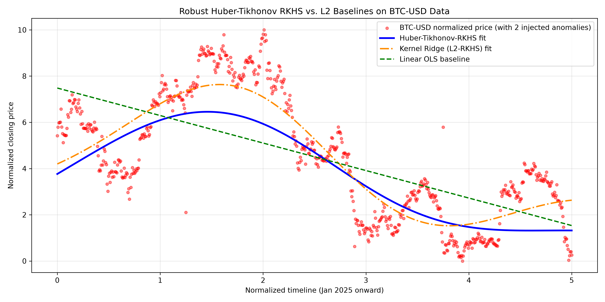

# Robust Regression Engine: Tikhonov-Regularized Huber Regression in RKHS

A Python implementation of **Tikhonov-Regularized Huber Regression** in a **Reproducing Kernel Hilbert Space (RKHS)**, combining an RBF kernel with Huber loss to limit the leverage of heavy-tailed noise and isolated outliers when estimating underlying trends.

## Theoretical Background

The estimator solves the regularized empirical risk minimization problem:

$$\hat{f} = \arg\min_{f \in \mathcal{H}_K} \frac{1}{n} \sum_{i=1}^{n} L_\sigma(y_i - f(x_i)) + \lambda \Vert{}f\Vert{}_{\mathcal{H}_K}^2$$

1. **Huber Loss ($L_\sigma$):** Applies a quadratic penalty for residuals $\vert{}r\vert{} \le \sigma$ and a linear penalty for $\vert{}r\vert{} > \sigma$, bounding the influence of extreme anomalies.
2. **RKHS / RBF Kernel:** Maps scalar inputs into a higher-dimensional feature space via $K(x, x') = \exp(-\gamma \Vert{}x - x'\Vert{}^2)$ to capture non-linear trend curvature.
3. **Tikhonov Regularization ($\lambda \Vert{}f\Vert{}_{\mathcal{H}_K}^2$):** Penalizes function complexity in the RKHS norm to prevent overfitting local volatility.

**Reference:** Hongzhi Tong, "Learning theory of regularized Huber regression," *Applied and Computational Harmonic Analysis*, 85 (2026), 101894.

### Theoretical Scope vs. Empirical Demo

- **Asymptotic Conditions:** Tong (2026) establishes minimax learning rates under symmetric noise with finite $p$-th moments ($1 < p \le 2$) when $\lambda$ and $\sigma$ follow explicit sample-size-dependent decay schedules (Theorem 1). This script uses fixed heuristic parameters (`lambda_param=0.008`, `sigma=0.5`, `gamma=0.3`) rather than theoretically scheduled rates.
- **Noise Symmetry:** Financial return series exhibit asymmetric tail behavior (sharp drawdowns vs. gradual rallies), meaning theoretical guarantees under symmetric noise do not transfer directly to live market forecasting.

## Empirical Comparison

The script `robust_regressor.py` fits three estimators on normalized BTC-USD daily closing prices ($n = 693$, January 2025 onward via Yahoo Finance) with two synthetic outliers injected at the 25% and 75% time indices:

1. **Huber-Tikhonov-RKHS** (non-linear RBF kernel + robust Huber loss)
2. **Kernel Ridge Regression** (identical RBF kernel and regularization weight, but standard $L_2$ squared loss)
3. **Linear OLS** (standard linear $L_2$ baseline)

### Evaluation at Injected Anomaly Coordinates

| Metric / Model | Index 1 (25% Mark) | Index 2 (75% Mark) |
| :--- | :---: | :---: |
| **Original Clean Value** | `7.103` | `0.792` |
| **Corrupted Target ($\pm 5.0$)** | `2.103` | `5.792` |
| **Huber-Tikhonov-RKHS Fit** | `6.376` | `1.703` |
| **Kernel Ridge ($L_2$-RKHS) Fit** | `7.340` | `1.533` |
| **Linear OLS Baseline** | `5.996` | `3.021` |

Because a single isolated outlier has limited leverage under strong global smoothing ($\lambda = 0.008$), both RKHS estimators resist single-point spikes; the linear OLS baseline, lacking local flexibility, shifts substantially toward the second outlier (`3.021` vs. `0.792`).

## Usage

~~~bash
pip install numpy scipy scikit-learn matplotlib yfinance
python3 robust_regressor.py
~~~

## Limitations

- **Manual Hyperparameters:** `lambda_param`, `sigma`, and `gamma` are fixed manually rather than selected via cross-validation or the theoretical sample-size schedule.
- **Single-Point Outlier Regime:** With strong Tikhonov smoothing, single isolated spikes exert limited pull even on Kernel Ridge; testing clustered bursts of consecutive outliers better highlights the separation between Huber and $L_2$ losses.
- **Optimizer Scaling:** Minimizing the dual objective via `scipy.optimize.minimize` (BFGS without an analytic gradient) scales at $\mathcal{O}(n^3)$ with kernel matrix operations; an Iteratively Reweighted Least Squares (IRLS) solver would improve runtime on larger datasets.
- **Retrospective Smoothing:** Kernel smoothing estimates historical trend structure and is not designed as a real-time trading or forecasting signal.

## License

MIT License — see [LICENSE](LICENSE) for details.
